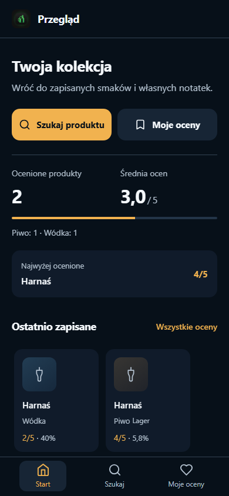
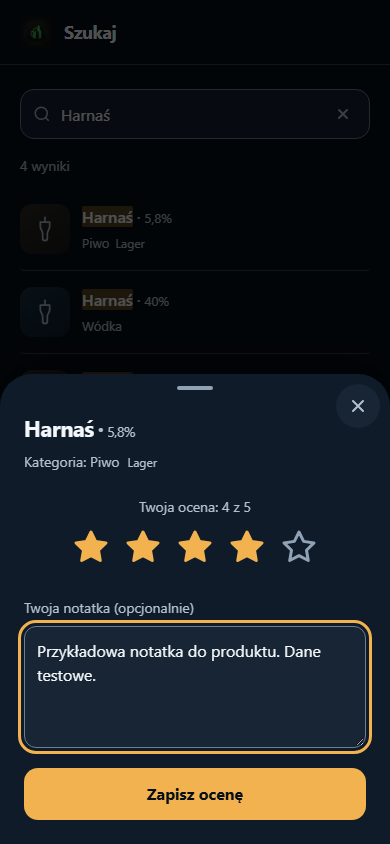

# AlkoRater

A personal catalogue of ratings and notes about beer, wine and vodka. The app's interface is in Polish and intended for adults. It runs in the browser without an account, sync service or application backend. It does not measure or track alcohol consumption.

[Open the app](https://t91a60.github.io/AlkoRater/) · [Report an issue](https://github.com/t91a60/AlkoRater/issues) · [Apache-2.0](LICENSE)

The package identifies this snapshot as `2.14.0-rc.1`. GitHub Pages serves the latest deployment from `main`, which may differ from a development branch. The existing [overhaul report](docs/ALKORATER_OVERHAUL_REPORT_PL.md) records earlier verification and limitations; those results are historical, not a claim about the live deployment.

## Use the app

- **Start** shows a ratings summary, recently saved products and backup controls.
- **Szukaj** searches the catalogue by name, brand, style, category, country and alcohol content where available. Search ignores letter case and Polish diacritics. Open a result, choose a rating from 1 to 5, and optionally add a note.
- **Moje oceny** filters saved entries by category and searches names, brands and notes. Edit or delete an entry; deletion offers an undo action.

### Catalogue

| File | Category | Products |
| --- | --- | ---: |
| `data/piwa.json` | Beer | 57 |
| `data/wodki.json` | Vodka | 184 |
| `data/wina.json` | Wine | 95 |
| Total | | 336 |

This is a limited local catalogue, not a source of prices, availability or store offers. Some products lack brand, country or style metadata. The current dataset has no actual product photographs: the UI uses a local placeholder and does not fetch the historical `dummyimage.com` URLs in the JSON files.

### Screenshots

These existing screenshots show the candidate UI with synthetic ratings and notes from an isolated test profile.

| Home | Rating form |
| --- | --- |
|  |  |

Other views: [search](docs/screenshots/after-search.png), [saved ratings](docs/screenshots/after-collection.png), [home before the changes](docs/screenshots/before-home.png).

## Data and privacy

Ratings and notes stay in this browser's storage. The app has no analytics, advertising, external image requests or remote fonts. Loading the app and checking for updates still contacts GitHub Pages, whose hosting policies apply.

Storage uses native IndexedDB, schema version 2. A one-time migration reads the old localStorage `favorites` value; an existing nonempty IndexedDB database takes precedence. The old copy remains available for recovery but is no longer synchronized.

When IndexedDB is unavailable, the app can select and remember a localStorage fallback. Writes in that mode require Web Locks. A normal transaction failure does not silently switch storage or replace records with an empty collection.

Browser storage is not a permanent archive. Clearing site data, private browsing, storage eviction or losing the device can remove entries. A different browser, profile, origin or device does not automatically receive them. A successful `navigator.storage.persist()` request is not a backup. Export JSON regularly.

## Back up and transfer ratings

On **Start**, expand **Kopia i przenoszenie danych**:

1. **Pobierz kopię JSON** downloads ratings and notes. Store the file outside the site's browser storage. It is readable, unencrypted JSON and may contain private notes.
2. On another device or after data loss, choose **Wczytaj kopię** and confirm the import.

The format includes `app: "AlkoRater"`, `schemaVersion: 1`, `exportedAt` and `records`. Files above 5 MB require an additional confirmation rather than being rejected solely for size. New notes have a 10,000-character editor limit; longer notes from older versions remain preserved.

The entire file is validated before writing. Import adds missing entries and skips conflicts with saved ratings; it does not replace existing ratings or synchronize newer edits between devices. Duplicate record IDs inside a backup reject the entire import. Repeated products with different entry IDs are skipped as duplicates.

If reading storage fails, do not clear site data. Use **Pobierz kopię odzyskiwania**, when offered, to download a raw recovery export for manual analysis. That format differs from the normal backup and cannot be imported directly. The app does not automatically import corrupt data.

See the Polish [data, migration and PWA guide](docs/DATA_AND_PWA_PL.md) for details.

## Offline use, installation and updates

The first visit requires a connection. Wait for the full catalogue and service worker installation, then reload while still online. **Aplikacja obsługiwana przez pamięć offline** on the home screen indicates service worker control. Test reopening with the network disconnected before relying on it.

The service worker caches the application shell and catalogue as a versioned set. An incomplete download rejects the new installation. A first visit without connectivity, or browser cache eviction, can prevent offline startup.

If shell files are missing, a recovery screen replaces the blank page; catalogue failures offer the same recovery action. **Napraw pamięć offline** requires a connection and closed additional tabs. It re-registers the worker and downloads application files without deleting IndexedDB or localStorage ratings. Do not substitute clearing site data for this operation.

| Platform | Installation |
| --- | --- |
| iPhone / iPad, Safari | Use Share → Add to Home Screen manually. |
| Android, Chrome / Edge | Use the browser's install or add-to-home-screen option if available. |
| Desktop, Chrome / Edge | Install if the browser offers it, or use a normal tab. |
| Other browsers | Use the website; installation and offline support depend on the engine and settings. |

There is no custom `beforeinstallprompt` install button. Installing the PWA does not back up or sync browser data. Export before uninstalling; storage retention across uninstall/reinstall depends on the browser and OS.

An open app waits for confirmation in its update banner. Save or close the rating form and close other AlkoRater tabs first. Updates do not force other tabs to reload, and the catalogue is not independently replaced in the background.

## Run locally

The app uses HTML, CSS and native JavaScript modules with no runtime dependencies or framework. Node.js is needed for development tools. `package.json` requires Node.js `^22.22.2 || ^24.15.0 || >=26.0.0`; CI uses Node.js 24. This does not establish compatibility with every permitted version.

```bash
git clone https://github.com/t91a60/AlkoRater.git
cd AlkoRater
npm ci
npm run dev
```

Open `http://127.0.0.1:4173/AlkoRater/`. Change the port with `npm run dev -- --port 4174`. The server exposes production application paths only and defaults to `Cache-Control: no-store`. `npm run dev:cache` enables caching for cache-related development. An existing worker can still serve older files; use a separate browser profile for code changes and test installation/update behavior separately.

Do not open `index.html` with `file://`. Service workers require HTTPS or a browser-recognized local secure context such as `localhost` or `127.0.0.1`. The supplied server binds only to `127.0.0.1`, so it does not expose the app to a phone on the LAN.

### Build and preview

Stop the development server first because preview uses the same default port:

```bash
npm run build
npm run preview
```

The build recreates `dist/` from an allowlist of production files. It does not bundle or transpile code, and it excludes tests, `node_modules`, repository configuration and documentation. Preview serves `dist/` at the same URL as development.

## Development checks

```bash
npm test
npm run check:data
npm run lint
npm run format:check
npm run build
npx playwright install chromium webkit firefox
npm run test:e2e -- --project=chromium
```

Vitest runs the unit tests. Browser tests start their own server at `http://127.0.0.1:4175/AlkoRater/`. Run the full matrix with `npm run test:e2e`: mobile `chromium`, `chromium-desktop`, `webkit` with an iPhone 13 profile, and `firefox`. Linux may need browser system libraries; CI installs Chromium with `--with-deps`.

Scenarios cover ratings, notes, keyboard use, backups, migration, concurrent tabs, storage errors, offline use and updates. Phone emulation is not a physical iPhone test. Verify iOS installation, device restart, actual storage retention and screen-reader behavior separately.

`check:data` is read-only: it checks stable IDs, alcohol percentages and contradictory labels, and reports unknown fields. It does not rewrite the catalogue or fetch network data. It replaces the old destructive `standardize-data.mjs` approach.

Use a separate profile and synthetic notes for manual checks: verify saving across reloads, non-overwriting imports, two-tab conflicts and offline reopening. Preserve real user data while testing cache recovery.

The earlier [overhaul report](docs/ALKORATER_OVERHAUL_REPORT_PL.md) records toolchain risks, including high-severity findings in development dependencies. These packages are excluded from the browser build; review current dependency reports separately rather than treating historical counts as current results.

## Structure and deployment

```text
data/                 local product catalogues
src/js/app/           application state and constants
src/js/data/          product identity and rating repository
src/js/services/      storage, backup, search and worker integration
src/js/ui/            views and interactions
src/css/              styles
scripts/              static server and dist staging
tests/e2e/            browser tests
docs/                 design decisions, reports and screenshots
service-worker.js     versioned offline resource sets
manifest.json         PWA metadata
```

The Pages workflow publishes `dist/` on a push to `main`, or a manual run on `main`, after lint, formatting, unit tests and build checks. Pull-request CI additionally runs Chromium. Development branches are not automatically deployed.

GitHub Pages serves static files at `/AlkoRater/`; there is no API or server-side ratings store. The app cannot freely configure hosting HTTP/cache headers. Project-level `/AlkoRater/robots.txt` does not replace the domain's `/robots.txt`. The sitemap contains the app URL, not individual product pages or private ratings.

For changes to data and pull-request preparation, see [CONTRIBUTING.md](CONTRIBUTING.md). See [CHANGELOG.md](CHANGELOG.md) for history. The project uses [Apache License 2.0](LICENSE).
